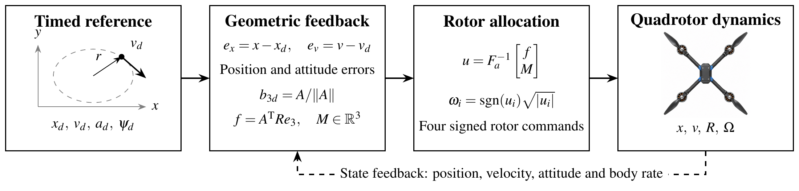

# LAB3 — Quadrotor Trajectory Planning and Tracking

**Shuyu Li · 24020036035**

This project implements circular trajectory generation and geometric quadrotor control for MIT VNAV LAB3. The English report covers quaternion conversions, rotor allocation, drag compensation, fourteen numerical conditions, and flight evaluation in the official Unity simulator.



## Report and demonstration

| Item | Location |
|---|---|
| Final report | [Read the PDF](lab3/24020036035_ShuyuLi_LAB3_Report.pdf) |
| Submission package | [Download the ZIP](24020036035_ShuyuLi_LAB3.zip) |
| RViz flight demonstration | [Watch on Google Drive](https://drive.google.com/file/d/15DyX_9IlpTixtrpF2S3K7VUW3vkl9Vee/view?usp=sharing) |
| Local RViz recording | [rviz_drone_flight.mp4](lab3/rviz_drone_flight.mp4) |
| Unity recording | [lab3_heightfix_unity.mp4](lab3/lab3_heightfix_unity.mp4) |
| Assignment | [MIT VNAV LAB3 exercises](https://vnav.mit.edu/labs_2023/lab3/exercises.html) |

## Project contents

```text
lab3/
├── 24020036035_ShuyuLi_LAB3_Report.pdf
├── deliverable_1.txt          Quaternion and rotation conversions
├── ros_ws/src/
│   ├── controller_pkg/       Controller, trajectory publisher and RViz configuration
│   └── mav_msgs/             Actuator messages
├── flight/                   Recorded flight CSVs and numerical summaries
├── report/                   LaTeX source, figures and numerical experiments
├── runtime/                  ROS–Unity bridge and transport relay
├── rviz_drone_flight.mp4
├── rviz_drone_flight.txt      Public video link
└── lab3_heightfix_unity.mp4
```

## Controller and trajectory

The trajectory publisher supplies position, velocity, acceleration and tangent heading on a circle with a radius of 5 m and a height of 2 m. A four-second smooth startup introduces the reference motion. The delivered launch configuration uses a time scale of 4 s, corresponding to a cruise speed of 1.25 m/s.

Position feedback determines the desired thrust direction. Geometric attitude feedback then produces the body moment, and the allocation matrix converts the wrench into four signed rotor-speed commands. The controller converts world-frame angular velocity into the body frame and includes an altitude integral with bounded accumulation.

## Build and launch the ROS package

Use Ubuntu 20.04 with ROS Noetic, catkin and Eigen3. Install the ROS packages named in `controller_pkg/package.xml`, together with RViz, before building. The supplied `mav_msgs` package provides the actuator message definitions.

From this directory:

```bash
source /opt/ros/noetic/setup.bash
cd lab3/ros_ws
catkin_make -DCMAKE_BUILD_TYPE=Release
source devel/setup.bash
roslaunch controller_pkg traj_tracking.launch
```

In another terminal, source the same workspace and open the visualization:

```bash
roslaunch controller_pkg visualize.launch
```

The simulator bridge must publish `/current_state` as `nav_msgs/Odometry` and receive `/rotor_speed_cmds` as `mav_msgs/Actuators`. The trajectory publisher provides `/desired_state` as `trajectory_msgs/MultiDOFJointTrajectoryPoint`. Follow the MIT instructions to obtain and start the official Unity simulator and its ROS bridge. The files in `runtime/` support the split-host setup described in the report; `run_flight.sh` expects the project to be mounted at `/lab3`.

## Recorded flight results

| Measurement | Initial flight | Independent re-flight |
|---|---:|---:|
| Evaluation interval (s) | 30.00–105.78 | 20.02–99.88 |
| Samples | 1,614 | 910 |
| Position RMSE (m) | 0.2604 | 3.0199 |
| Time-weighted position RMSE (m) | 0.2687 | 2.9371 |
| Mean height bias (m) | −0.2491 | −0.03458 |
| Yaw RMSE (degrees) | 4.17 | 28.06 |
| Median state interval (s) | 0.040 | 0.080 |

The re-flight reduced the mean height offset while exhibiting larger position and heading errors. Its maximum state interval was 3.34 s. The recordings have different feedback timing, so the comparison describes the full closed loop. `unity_reflight.csv` and `unity_reflight_metrics.json` contain the current re-flight data and results. `postfix_flight_metrics.json` is a historical summary whose original CSV is unavailable.

## Numerical experiments and report source

The numerical studies use Python with NumPy, SciPy and Matplotlib. Figure generation also requires LaTeX with TikZ and Poppler's `pdftoppm`.

```bash
python3 -m pip install numpy scipy matplotlib
cd lab3/report
python3 run_experiments.py
python3 tune_attitude.py
python3 extend_analysis.py
python3 make_numbers.py
python3 plot_gain_diagnosis.py
```

To regenerate the re-flight plots and metrics from the recorded CSV, choose a separate output directory for the computed summary:

```bash
python3 analyze_ros_run.py ../flight/unity_reflight.csv \
  --start 20 --end 100 --out /tmp/lab3-reflight \
  --stem postfix_flight_metrics
```

Compile the report from `lab3/report`:

```bash
mkdir -p build
pdflatex -interaction=nonstopmode -halt-on-error -output-directory=build main.tex
pdflatex -interaction=nonstopmode -halt-on-error -output-directory=build main.tex
```

## Team responsibilities

| Member | Responsibility | Share |
|---|---|---:|
| Li Shuyu | Trajectory planning and flight tests | 20% |
| Deng Chengyang | Controller and gain tuning | 20% |
| Zhou Jingxin | Unity–ROS integration and tests | 20% |
| Zhou Chunyang | Flight logs and error analysis | 20% |
| Zhang Yuxin | Visualization and report review | 20% |

Li Shuyu's individual contribution is detailed in the report, including trajectory parameterization, startup design, comparative experiments and flight evaluation.
