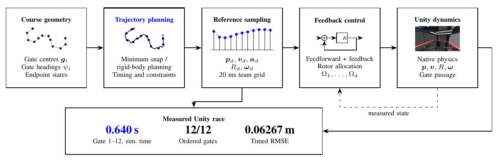
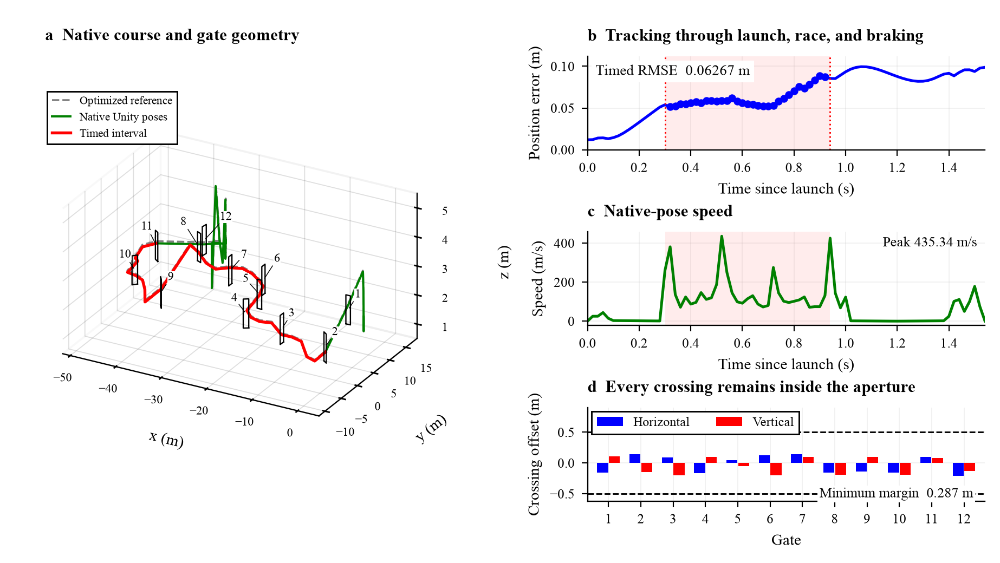

# LAB4 · Drone Racing

Polynomial trajectory optimization, controller-aware timing, and a twelve-gate Unity race.

[Read the report](24020036035_ShuyuLi_Lab4/24020036035_ShuyuLi_LAB4_Report.pdf) · [Watch the flight](24020036035_ShuyuLi_Lab4/team%20task/flight.mp4) · [Browse the controller](24020036035_ShuyuLi_Lab4/team%20task/scripts/rigid_reference_node.py)



## Race result

| Measurement | Recorded value |
|---|---:|
| Gate 1 → gate 12 | **0.639704 s** |
| Gates passed in order | **12 / 12** |
| Position RMSE during the timed interval | **0.06267 m** |
| Maximum position error during the timed interval | 0.08868 m |
| Launch → gate 12 | 0.939843 s |
| Minimum crossing-point aperture margin | 0.28701 m |
| Racing and braking collision events | 0 |
| Peak rotor command / configured limit | 1948.38 / 2000 rad/s |

Times use the **Unity simulation clock**. Gate events use cubic Hermite interpolation between native 20 ms state samples. The wall-clock recording and simulation clock run at different rates during synchronous control and capture.



## Individual work

The report derives the single-segment quadratic programs and multi-segment minimum-snap conditions, then compares trajectory smoothness and tracking at matched durations. The numerical study includes time scaling, acceleration lag, command saturation, and a 25-setting response-time sweep.

At a fixed 12 s duration, freeing internal waypoint derivatives reduces snap cost from 40414.50 to 414.15. The global reference has 0.0456 m tracking RMSE, compared with 0.3349 m for the stopping reference under the same reduced translational model and feedback gains.

- [Course exercise code](24020036035_ShuyuLi_Lab4/person%20task/code/)
- [Numerical experiments and plotting scripts](24020036035_ShuyuLi_Lab4/person%20task/experiments/)
- [Saved numerical results](24020036035_ShuyuLi_Lab4/person%20task/experiments/results.json)

## Rebuild the figures and report

From the repository root, create a Python environment and install the plotting and numerical dependencies:

```bash
python3 -m venv .venv-lab4
source .venv-lab4/bin/activate
python -m pip install -r Lab4/requirements.txt
make -C Lab4 figures
```

The figure target reads the supplied numerical and flight data. It recreates the report figures, including the first-page graphics, three-dimensional course, rotor panels, and flight storyboard.

To solve the individual trajectory problems again and rerun the tracking, ablation, and response-time experiments:

```bash
make -C Lab4 experiments
```

This target updates the individual numerical result files. Run `make -C Lab4 report` afterward to include those results in newly drawn figures.

With `pdflatex` installed, build the English two-column report:

```bash
make -C Lab4 report
```

Use a TeX Live installation containing the standard LaTeX packages, TikZ, `capt-of`, and Times fonts. The document class is included. Plot text uses Times New Roman when available and a serif fallback otherwise.

`PYTHON` and `PDFLATEX` can select alternate executables:

```bash
make -C Lab4 report PYTHON=/path/to/python PDFLATEX=/path/to/pdflatex
```

## Run the Unity controller

The team implementation uses ROS Noetic and the configured Windows/WSL Unity runtime. Its reference trajectory, gains, launch files, and ROS package sources are included.

On that configured machine, open PowerShell in `Lab4/24020036035_ShuyuLi_Lab4/team task` and run:

```powershell
powershell -NoProfile -ExecutionPolicy Bypass -File ".\local\Start-SubsecondInteractive.ps1"
```

See the [team runtime guide](24020036035_ShuyuLi_Lab4/team%20task/README.md) for the expected installation and control-panel actions. The simulator and ROS installation are separate dependencies. Offline rigid-body optimization additionally uses CasADi.

## Files

| Location | Contents |
|---|---|
| `24020036035_ShuyuLi_Lab4/24020036035_ShuyuLi_LAB4_Report.pdf` | Final English report |
| `24020036035_ShuyuLi_Lab4/person task/` | Individual exercise code, numerical experiments, and plotting scripts |
| `24020036035_ShuyuLi_Lab4/team task/` | Unity/ROS controller, optimized reference, settings, flight video, and rosbag |
| `24020036035_ShuyuLi_Lab4/report/source/` | LaTeX manuscript, document class, vector figures, and original gate frames |
| `24020036035_ShuyuLi_Lab4/report/build/` | Local report-build output |

The [rosbag](24020036035_ShuyuLi_Lab4/team%20task/data/race.bag) and [native state samples](24020036035_ShuyuLi_Lab4/team%20task/data/actual_states.csv) accompany the flight video. Individual reduced-model experiments and Unity flight measurements are reported separately.

## Team

| Member | Main responsibility | Share |
|---|---|---:|
| Li Shuyu | Trajectory planning and optimization; entry, racing, braking, and feasibility constraints | 20% |
| Deng Chengyang | Feedback gains, rotor allocation, position errors, and rotor limits | 20% |
| Zhou Jingxin | Unity/ROS integration, synchronous stepping, and state alignment | 20% |
| Zhou Chunyang | Ordered gate timing, bag replay, and contact checks | 20% |
| Zhang Yuxin | Video alignment, figures, and repeated-run summaries | 20% |

## Course resources

- [MIT VNAV LAB4 exercises](https://vnav.mit.edu/labs_2023/lab4/exercises.html)
- [VNAV2021 course code](https://github.com/MIT-SPARK/VNAV-labs/releases/tag/VNAV2021)
