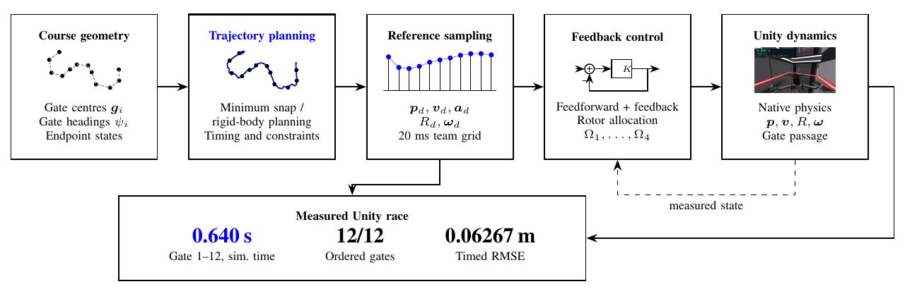
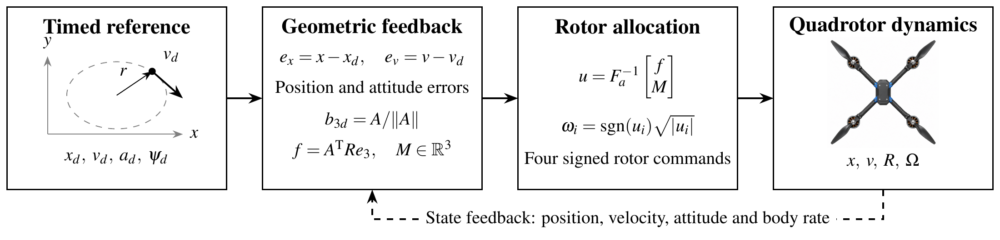

# summer_2026

机器人集成课程实验仓库，收录桌面物体检测、机械臂抓取仿真，以及 MIT VNAV LAB3 轨迹跟踪与 LAB4 无人机竞速。

## 实验导航

| 项目 | 内容与入口 |
| --- | --- |
| 桌面物体识别 | [训练、推理、ROS2 与实验报告](desktop_object_detection/) |
| 机器人抓取仿真 | [仿真程序与配置](robot_pick_place_sim/) |
| 机械臂抓取接口 | [关节控制与抓取说明](robot_grasp_joint/README.md) |
| LAB3 无人机轨迹跟踪 | [项目说明、报告、源码、数据与视频](Lab3/) |
| LAB4 无人机竞速 | [成绩、报告、飞行视频与图表复现](Lab4/README.md) |

## LAB4 · 无人机控制与竞速

| 首门至末门仿真时间 | 按序通过 | 计时区间位置 RMSE |
|---:|---:|---:|
| **0.639704 s** | **12 / 12** | **0.06267 m** |

单段与多段轨迹优化、时长缩放、控制响应分析，以及 Unity 赛道实测结果均收录于 LAB4。提供英文双栏报告、代码、图表源码、飞行视频和 rosbag。

[查看 LAB4 报告](Lab4/24020036035_ShuyuLi_Lab4/24020036035_ShuyuLi_LAB4_Report.pdf) · [观看飞行视频](Lab4/24020036035_ShuyuLi_Lab4/team%20task/flight.mp4) · [运行与复现](Lab4/README.md#rebuild-the-figures-and-report)

## LAB3 无人机轨迹规划与控制

LAB3 包含英文双栏报告、旋转表示与控制分配推导、十四种数值实验条件、ROS Noetic 控制器，以及官方 Unity 仿真中的飞行数据和 RViz 演示。

- [阅读最终报告](Lab3/lab3/24020036035_ShuyuLi_LAB3_Report.pdf)
- [下载完整交付包](Lab3/24020036035_ShuyuLi_LAB3.zip)
- [观看 RViz 绕圈视频](https://drive.google.com/file/d/15DyX_9IlpTixtrpF2S3K7VUW3vkl9Vee/view?usp=sharing)
- [查看编译步骤、实验结果与团队分工](Lab3/README.md)

## 实验一当前状态

| 验收项 | 要求 | 当前证据 | 状态 |
| --- | ---: | --- | --- |
| 同时识别 | 不少于 2 类 | MIX 测试图同时检出 5 类 | 已完成 |
| 20 个目标正确率 | 不低于 80% | 19/20，95% | 已完成 |
| Jetson 实时速度 | 不低于 5 FPS | 仅完成 Mac MPS 测试 | 待 Jetson 实测 |
| ROS2 发布 | 发布识别结果 | 节点及静态自检已完成 | 待 Jetson 实机验证 |

当前验收版数据固定为 5,000 张：1,000 张自主采集来源素材和 4,000 张 Open Images V7 公开数据。自主采集来源素材由 10 张原始实拍照片生成 100 个可追溯版本，共 1,000 张，其中 990 张为确定性增强，并不等同于 1,000 次独立按快门。该计数方式已由数据集所有者确认；提交时仍须向教师如实说明。旧的 500 张 P05 混合基线（含生成图）仅保留为历史材料，不进入本验收版。

## 目录

- `Lab3/`：无人机轨迹跟踪、控制分配、ROS/Unity 飞行数据与报告。
- `Lab4/`：无人机轨迹优化、竞速控制、实验数据、报告与图表源码。
- `data/`：500 张 P05 历史基线原图、YOLO 标签和逐图来源记录。
- `desktop_object_detection/`：训练、推理、评估、ROS2、模型、结果和文档。
- `desktop_object_detection/datasets/experiment1_1000self_4000public_v1/`：当前 1,000 + 4,000 验收版数据。
- `desktop_object_detection/docs/RUN_GUIDE.md`：完整运行说明。
- `desktop_object_detection/docs/EXPERIMENT_REPORT.md`：实验报告。

当前训练集的 1,000 张实拍衍生图以及复用的公开原图由 Git LFS/软链接管理。首次克隆前请安装 Git LFS，克隆后运行 `git lfs pull`。逐图来源、母图 SHA256、增强参数和划分信息均随仓库提交。

## 提交约定

后续修改继续按一个可验证里程碑一个提交：数据变更、训练管线、推理功能、ROS2、验收结果和文档分别提交。提交信息使用 `data:`、`feat:`、`test:`、`model:`、`docs:`、`fix:` 等前缀，不把无关修改混在同一提交中。
