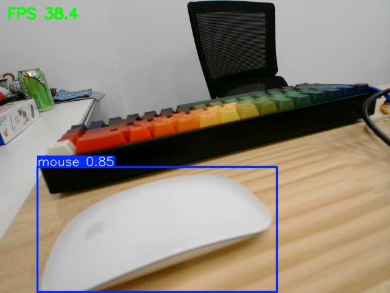

# Jetson 实机环境与性能结果

本表记录为 Jetson 实机、USB 摄像头和当前验收权重的当场测量结果。

## 环境配置

| 字段 | 实测或已核对值 |
| --- | --- |
| Jetson 型号与内存 | NVIDIA Jetson Orin NX Engineering Reference Developer Kit Super；16 GB（系统可见 `16031376 kB`，约 15.29 GiB） |
| 系统软件 | JetPack 6.2.1；L4T 36.4.4；CUDA runtime 12.6.77；TensorRT libraries 10.7.0.23；ROS2 Humble |
| 功耗配置 | `nvpmodel`: `MAXN_SUPER` / mode 0；`jetson_clocks` 未启用（动态调频，`FreqOverride=0`） |
| 模型配置 | `models/experiment1_1000self_4000public_v1/best.pt`；YOLO11n；PyTorch 2.5.0 NVIDIA build 后端；CUDA GPU device 0 |
| 计算精度 | FP16 |
| 输入配置 | 模型输入 `640×640`；`HDR CAMERA-A` USB 摄像头 `/dev/video0`；实际取帧 `640×480` |
| 检测阈值 | confidence `0.50`；NMS IoU `0.45` |

说明：当前推理后端为 PyTorch FP16，不是 TensorRT。系统存在 TensorRT 运行库，但当前 Python `tensorrt` binding 未安装，因此本表不把 TensorRT 库存在误报为 TensorRT 模型实测。

## 性能结果

| 字段 | 实测值 |
| --- | --- |
| 预热与计时规模 | 预热 20 帧；正式计时 200 帧 |
| 计时边界 | 计时 `model.predict()` 整体：包含 Ultralytics 预处理、GPU 推理和后处理；排除摄像头 `capture.read()`、绘框、视频/日志保存和 ROS2 发布 |
| 平均预测调用耗时 | `25.951 ms/frame`（完整 `model.predict()` 调用）；其中模型报告的平均 inference 为 `20.575 ms/frame` |
| 平均 FPS | `38.534 FPS` |
| 最低 FPS / 稳定性 | 最低 `37.952 FPS`；最大 inference 时延 `20.896 ms` |
| ROS2 结果主题频率 | `/object_detection/result`: `29.99 Hz`（15 s 采样，`--window 200`）；摄像头输入约 30 FPS |
| 验收阈值 | `5 FPS` |
| 判定 | **PASS**；平均 FPS 约为阈值的 7.71 倍，ROS2 结果主题频率也高于阈值 |

## 复现命令

```bash
cd ~/desktop_object_detection
python3 scripts/benchmark.py \
  --model models/experiment1_1000self_4000public_v1/best.pt \
  --source 0 --device 0 --half --imgsz 640 \
  --warmup-frames 20 --test-frames 200 \
  --requirement-fps 5 \
  --output outputs/benchmark/jetson_orin_nx_camera.csv
```

ROS2 频率测量：

```bash
source /opt/ros/humble/setup.bash
ros2 topic hz /object_detection/result --window 200
```

原始 benchmark CSV 位于 Jetson：
`~/desktop_object_detection/outputs/benchmark/jetson_orin_nx_camera.csv`。

## 实时检测画面

2026-09-05 18:54:00（UTC+8），从 Jetson 当前运行的 MJPEG 检测流取得一帧
`640×480` 原始输出。该帧检测到 `mouse`，置信度为 `0.85`；左上角的
`38.4 FPS` 为检测程序按预测调用耗时计算的指数平滑显示值，不替代上表的
200 帧 benchmark 结果，也不替代 ROS2 topic 频率测量。



图像 SHA-256：
`23d1e0b327de6f4c55a2570f650e474d971a1dc43024ded40018833a461494a6`。

## 实时结果视频

2026-09-05 19:38:50（UTC+8）起，从同一 Jetson MJPEG 检测流连续采集
30.000 s，并保存为：

[outputs/videos/jetson_live_detection_20260905_193850.mp4](../outputs/videos/jetson_live_detection_20260905_193850.mp4)

视频采用 H.264 编码，分辨率为 `640×480`，共 900 帧，以 30 帧/s 封装，
文件大小为 1,539,189 B。封装帧率仅用于视频回放，不作为模型性能或 ROS2
发布频率的测量值。

视频 SHA-256：
`df54c64684ec047ddbe75f31dd2aaf4ea56db65fb6abdd1f95595f3d82a8a8c1`。
